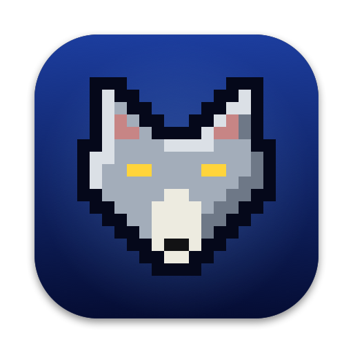

<p align="center">
  
</p>

<h1 align="center">MetalWolf</h1>

<p align="center"><b>Wolfenstein 3D, native on Apple silicon Macs.</b></p>

<p align="center">
  The original game on <a href="https://github.com/fabiangreffrath/wolf4sdl">Wolf4SDL</a>, drawn with Metal at
  your display's full resolution, with gore and DualSense haptics. Bring your own game files.
</p>

<p align="center"><b>MetalWolf 1.0.0</b></p>

<p align="center">
  <a href="https://github.com/erhansavas/MetalWolf/actions/workflows/ci.yml"></a>
  <a href="https://github.com/erhansavas/MetalWolf/releases/latest"></a>
  <a href="LICENSE"></a>
  
</p>

> **Game data:** MetalWolf includes no game data. You need the files of Wolfenstein 3D version 1.4 from
> your own copy (GT/Activision or Apogee), or the free shareware episode.

## Features

- **The original game:** its rules, with the GT/Activision, Apogee and shareware editions recognised
  automatically.
- **Sharp and smooth:** your display's full resolution and frame rate (60 fps on most Macs, 120 fps on
  ProMotion displays), including the full notched screen.
- **Adaptive resolution:** when a frame would miss the display (a heavy scene, a hot Mac, Low Power Mode),
  the view is rendered smaller and filtered smoothly, then climbs back to full size.
- **Status bar card:** the original status bar as a compact, pixel-perfect card at the foot of the screen.
- **Gore:** blood that sprays, stains walls and floors, runs down walls and pools under bodies, footprints,
  fragments, hit reactions and its own sounds. Built outside the game engine and spread over every CPU
  core, heavy gore never slows the game. Purely cosmetic: it never changes the game, and it is off in demos.
- **Game controllers:** DualSense haptics and adaptive triggers; Xbox, DualShock and other controllers work
  too. The menus show the buttons of the controller you use.

## Install

MetalWolf runs on Apple silicon Macs (M1 and later) with macOS 13 Ventura or later. Nothing else to install.

1. From [Releases](https://github.com/erhansavas/MetalWolf/releases/latest), download
   `MetalWolf-1.0.0-macOS-arm64.dmg`, open it and drag **MetalWolf** to the **Applications** folder.
2. The app is free and not notarized by Apple, so macOS blocks its first launch: choose **Done**, open
   **System Settings › Privacy & Security**, scroll down and choose **Open Anyway**. You only do this once.
3. On first launch MetalWolf looks for the game files in `~/Library/Application Support/MetalWolf/` and in
   the usual Steam folder, or asks you to select the folder with them (`VSWAP.WL6` and the other `.WL6`
   files, or `.WL1` for the shareware episode). Your files stay where they are; MetalWolf remembers them.

To verify the download: `shasum -a 256 -c MetalWolf-1.0.0-macOS-arm64.dmg.sha256`

Your saves are kept in `~/Library/Application Support/MetalWolf/`.

## Controls

The game starts fullscreen. Everything else is in the menu (**Esc**); **Settings › Controls** also lets you
change the keyboard and mouse buttons.

| Keyboard and mouse | |
| --- | --- |
| **W S** or up/down arrows | Move |
| **A D** | Strafe |
| **Q E**, left/right arrows or mouse | Turn |
| Left click or **Control** | Fire |
| **Space** or **Return** | Open doors, push walls |
| **Shift** | Run |
| **Alt** | Strafe with the arrow keys |
| **1**…**4** | Knife, pistol, machine gun, chain gun |
| **F8** / **F9** | Quick save / quick load |
| **Esc** | Menu |
| **⌘Q** | Quit |

| Controller | DualSense | Xbox |
| --- | --- | --- |
| Move / turn | Left stick / right stick | Left stick / right stick |
| Fire | R2 | RT |
| Use | Cross, R3 | A, R3 |
| Run | Circle, L2, L3 | B, LT, L3 |
| Previous / next weapon | L1 / R1, Triangle | LB / RB, Y |
| Chain gun, machine gun, pistol, knife | D-pad up, right, down, left | D-pad up, right, down, left |
| Status bar | Touchpad | — |
| Menu / pause | Options / Create | Menu / View |

**Settings › Controller** shows the buttons of the connected controller and adjusts vibration, triggers,
stick dead zone and turn speed. With more than one controller connected, the one you used last plays.

## Build from source

Apple silicon and Xcode (its compiler, the macOS SDK and the Metal compiler).

```sh
make                        # the app: build/release/MetalWolf.app
make test                   # unit tests, no game data needed
make dmg                    # the signed app's disk image and its SHA-256: build/release/
make CONFIG=sanitize test   # the same tests under AddressSanitizer and UBSan
```

If Xcode reports a missing Metal toolchain: `xcodebuild -downloadComponent MetalToolchain`.

The app holds a small launcher (`MetalWolf`) that finds the game files, recognises their edition and
starts the matching engine (`Wolf-gt`, `Wolf-apogee` or `Wolf-shareware`). To choose the files and a
separate settings folder from the command line:

```sh
build/release/MetalWolf.app/Contents/MacOS/MetalWolf --data /path/to/wolf3d --home /path/to/folder
```

Other options go to the engine (Wolf4SDL's own, such as `--nowait` and `--tedlevel`).

## Reporting problems

Found a bug? Open an [issue](https://github.com/erhansavas/MetalWolf/issues) with your Mac, macOS version,
game edition and what happened.

## License

GNU General Public License, version 2: see [LICENSE](LICENSE). The AdLib emulator, Nuked OPL3, is under the
GNU LGPL 2.1 or later: see [LICENSE-LGPL-2.1.txt](LICENSE-LGPL-2.1.txt). [NOTICE.txt](NOTICE.txt) has the
full origin and license notes. Changes: [CHANGELOG.md](CHANGELOG.md).

MetalWolf is not affiliated with id Software or ZeniMax Media. Wolfenstein is a trademark of ZeniMax Media.
